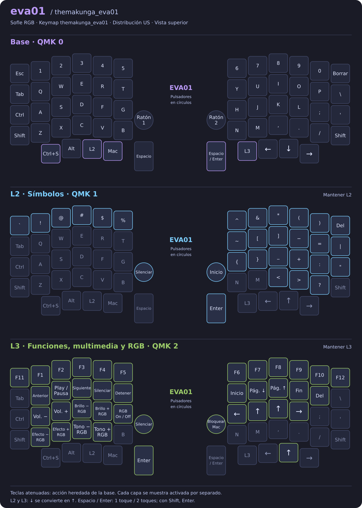
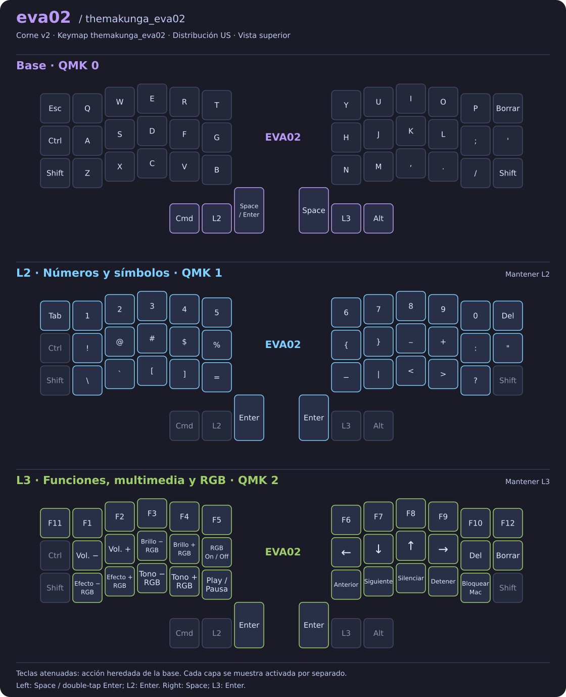

# Keyboards

[](https://github.com/themakunga/keyboards/actions/workflows/checks.yaml)
[](https://github.com/themakunga/keyboards/actions/workflows/firmware.yaml)
[](https://github.com/themakunga/keyboards/releases)
[](https://github.com/qmk/qmk_firmware/tree/b1aea2556040c28d58d611c8aef0082b5780bb6d)

Configuraciones y mapas de teclas personales para [QMK Firmware](https://qmk.fm/), organizados como
un [espacio de usuario externo](https://docs.qmk.fm/newbs_external_userspace).

|                           EVA-01 · Sofle RGB                           |                             EVA-02 · Corne                             |
| :--------------------------------------------------------------------: | :--------------------------------------------------------------------: |
|                                   |                                   |
| [EVA-01 keymap](keyboards/sofle/v2/keymaps/themakunga_eva01/readme.md) | [EVA-02 keymap](keyboards/corne/v2/keymaps/themakunga_eva02/readme.md) |

## Teclados registrados

| Keyboard  | Version | QMK target | Keymap                          | Documentation                                                                      |
| --------- | ------- | ---------- | ------------------------------- | ---------------------------------------------------------------------------------- |
| Sofle RGB | v2      | `sofle/v2` | `themakunga_eva01_{left,right}` | [Hardware, layout and OLED](keyboards/sofle/v2/keymaps/themakunga_eva01/readme.md) |
| Corne     | v2      | `corne/v2` | `themakunga_eva02_{left,right}` | [Hardware, layout and OLED](keyboards/corne/v2/keymaps/themakunga_eva02/readme.md) |

`users/eva/` contains the shared OLED code and font. Each keyboard builds separate `_left` and
`_right` firmware: the left OLED shows layers, modifiers and the last keyboard output; the right
shows
[Luna, the keyboard pet](https://github.com/HellSingCoder/qmk_firmware/tree/33d7fa1180d232dcdb024c68a8f4629dced32afb/keyboards/sofle/keymaps/helltm).
Luna sits, walks or runs with typing speed, sneaks with Control, barks with Caps Lock and jumps on
Space. USB stays on the left during normal use. Each image contains only its side's OLED content,
and fixed master/peripheral roles let LTO remove unused paths.

Hardware definitions are grouped by keyboard family and version; personal keymaps live beneath
`keymaps/`:

```text
keyboards/
├── sofle/v2/
│   ├── keyboard.json
│   └── keymaps/themakunga_eva01/
└── corne/v2/
    ├── keyboard.json
    └── keymaps/themakunga_eva02/
```

## Distribución de eva01



La imagen muestra cada capa por separado, con la posición física de las 58 teclas y los dos
pulsadores de los codificadores. Las teclas atenuadas heredan la acción de la capa base. Los
círculos representan los pulsadores; los giros están detallados en la
[guía de eva01](keyboards/sofle/v2/keymaps/themakunga_eva01/readme.md#capas-y-controles).

- **Base (QMK 0):** QWERTY, Ctrl en la posición de bloqueo de mayúsculas y **Ctrl+S** en la esquina
  inferior izquierda. **Mac** envía Command y está entre **L2** y Espacio.
- **L2 · Symbols (QMK 1):** hold **L2** (`MO(1)`) for symbols. Both inner Space thumb keys send
  Enter.
- **L3 · Funciones y multimedia (QMK 2):** mantener **L3** (`MO(2)`) activa F1–F12, controles
  multimedia, navegación y RGB.
- **Espacio / Enter:** en la base, la tecla del pulgar derecho envía Espacio con un toque y Enter
  con dos; Shift más esa tecla también envía Enter.

On L2 and L3, both inner Space thumb keys send Enter directly, including when both layers are held.

Configura la distribución **US** en el sistema operativo. En L2 y L3, el código convierte todas las
acciones `KC_DOWN` en Arriba; la imagen muestra ese resultado. En la base, Abajo se conserva.

Firmware builds use QMK revision `b1aea2556040c28d58d611c8aef0082b5780bb6d` (0.34.5). Verify the
physical board and controller before flashing firmware.

## Distribución de eva02



The 42-key Corne v2 targets Pro Micro ATmega32U4 and keeps EVA01's letter columns, Ctrl on the A row
and three layers. From left to right, its thumb keys are **Command · L2 · Space/Enter** on the left
and **Space · L3 · Alt** on the right.

On the base, the inner left thumb sends Space on one tap and Enter on a double tap; Shift also
produces Enter. The inner right thumb sends Space. Both keys send Enter directly on L2 and L3,
including when both layers are held. Hold **L2** for numbers and symbols or **L3** for F1–F12,
navigation, multimedia and RGB. All four arrows remain on H/J/K/L of L3. See the
[EVA02 guide](keyboards/corne/v2/keymaps/themakunga_eva02/readme.md) for hardware requirements; the
standard controller profile is not for RP2040.

## Comprobaciones del repositorio

Con `pre-commit` disponible, activa los controles de Git:

```sh
pre-commit install
pre-commit run --all-files
```

Los controles verifican los mapas de ambos teclados, la imagen de eva02, el módulo OLED compartido,
YAML, JSON, formato, Markdown, ortografía en inglés y español, claves privadas y archivos grandes.
El control de mensajes exige Conventional Commits, por ejemplo `feat: add keyboard keymap`. GitHub
Actions ejecuta las mismas comprobaciones de archivos al publicar cambios y en las solicitudes de
integración.

La comprobación de Sofle necesita Python 3 y un compilador de C (`cc`):

```sh
python3 scripts/check_oled.py
python3 scripts/check_eva02.py
```

## Compilar los teclados

With QMK CLI, Git and the QMK toolchain available, run from this repository root:

```sh
make setup
# For a checkout in a different directory:
make setup QMK_HOME="/path/to/qmk_firmware"
```

`QMK_HOME` defaults to `$HOME/qmk_firmware`. If that path is absent, `make setup` downloads QMK
revision `b1aea2556040c28d58d611c8aef0082b5780bb6d` and its submodules into a temporary directory,
then places the completed checkout at `QMK_HOME`. A failed download leaves the destination absent
and can be retried. Existing checkouts are preserved; an incomplete directory or conflicting link is
rejected rather than overwritten.

Setup then links both keyboard revisions, saves QMK's firmware/userspace paths and runs
`qmk userspace-doctor`. QMK CLI and the compiler tools must already be available. Missing QMK CLI is
reported before downloading anything; activate the declared QMK toolchain first. Setup does not
install packages, switch system configuration or flash hardware.

```sh
make update
# With the same custom checkout used during setup:
make update QMK_HOME="/path/to/qmk_firmware"
```

`make update` refreshes the links to the local keyboard definitions, preserving QMK's existing
families and Sofle callbacks. Repeated runs are safe; conflicting files or links are rejected.
Source changes are visible immediately through the links. This command does not fetch newer QMK
revisions or update firmware on a connected keyboard.

The four side-specific targets work with standard QMK commands and userspace builds:

```sh
qmk compile -kb sofle/v2 -km themakunga_eva01_left
qmk compile -kb sofle/v2 -km themakunga_eva01_right
qmk compile -kb corne/v2 -km themakunga_eva02_left
qmk compile -kb corne/v2 -km themakunga_eva02_right
qmk userspace-compile
```

`qmk.json` registers all four targets. CI uses the same link-update target and the standard QMK
userspace workflow, producing the `Firmware` artifact consumed by releases.

## Build and flash with Make

Run these commands from the repository root after completing the QMK setup above. The shortcuts
select the keyboard and its keymap from the table above. GNU Make and an existing QMK development
environment are required; `setup` configures QMK; `update` refreshes links. Neither command installs
tools.

```sh
make help
make setup
make update
make build eva01
make flash-left eva01
make flash-right eva01
make build eva02
make flash-left eva02
make flash-right eva02
```

`make` without arguments shows help. `make build eva01` compiles **both halves** of Sofle;
`make build eva02` does the same for Corne. Output names end in `_left.hex` and `_right.hex`, for
example `sofle_v2_themakunga_eva01_left.hex` and `sofle_v2_themakunga_eva01_right.hex`. `flash-left`
and `flash-right` each compile and flash **only the selected side**. The old ambiguous
`flash`/`slash` commands are no longer accepted. Choose exactly one keyboard per command; invalid
arguments fail before QMK runs. A failed left build stops before attempting the right build.

For flashing, disconnect power before changing the split cable. Connect only the intended half over
USB, run its matching flash command and follow QMK's bootloader/reset prompt. Repeat for the other
half using its own command, then reconnect the split cable with power disconnected and return USB to
the left half for normal use. Side-specific firmware cannot be interchanged. The profiles target Pro
Micro ATmega32U4 with Caterina, not RP2040. Preview without hardware using
`make -n flash-right eva01`. See the [QMK flashing guide](https://docs.qmk.fm/newbs_flashing).

The command tests simulate QMK and never access hardware:

```sh
python3 -m unittest discover -s tests -p test_makefile.py
```

## Add a keyboard

Place its hardware definition in `keyboards/<family>/<version>/` and its keymap in
`keymaps/themakunga_<name>/` beneath that directory. Retain upstream copyright notices and licenses.
Add the hardware revision to `scripts/link-keyboards.sh`, then add the shortcut name to `KEYBOARDS`
and its `BOARD_<name>` mapping in the Makefile. The shortcut selects `themakunga_<name>_left` and
`themakunga_<name>_right`; keep shared key assignments in `themakunga_<name>` and use thin
side-specific wrappers. Register the hardware/keymap pair in `qmk.json`, and update the command
tests and documentation. The firmware workflow discovers registered targets automatically.

Generated firmware, temporary build output and local credentials are ignored by Git.

## Promover una versión

Abre **Actions → Promote release → Run workflow**, selecciona `main` y ejecútalo como `themakunga`.
El flujo utiliza la revisión exacta de `main` seleccionada al iniciar la ejecución.

Calcula la próxima versión estable `vMAJOR.MINOR.PATCH` a partir de los commits posteriores a la
versión estable más alta accesible desde esa revisión. `BREAKING CHANGE:`, `BREAKING-CHANGE:` o `!`
incrementan la versión mayor; `feat` incrementa la menor; `fix` incrementa el parche. En las
promociones manuales, otros commits nuevos también incrementan el parche. Se incluyen los commits de
integración, por lo que cuentan los Conventional Commits de las ramas integradas. En un repositorio
sin etiquetas, un primer `feat` produce `v0.1.0`.

The workflow compiles all four side-specific targets, downloads the firmware and atomically creates
`release/vMAJOR.MINOR.PATCH` and tag `vMAJOR.MINOR.PATCH` at the selected revision. It creates a
GitHub draft release, attaches the generated `.hex`, `.bin` and `.uf2` files and publishes only
after all uploads finish. Download each matching side from
**[Releases](https://github.com/themakunga/keyboards/releases)**.

Las promociones simultáneas se ejecutan en serie. Repetir una ejecución para una revisión ya
etiquetada reutiliza su versión: permite completar un borrador pendiente y conserva intacta una
versión publicada. El flujo no publica cambios en `main` ni graba firmware en el teclado.
