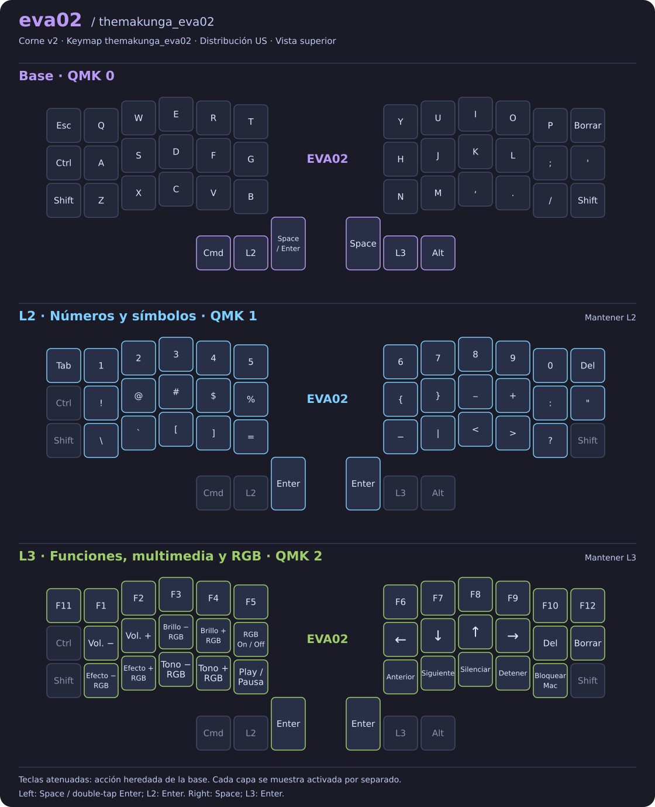

# eva02 — Corne v2

The `themakunga_eva02` QMK keymap targets `corne/v2`, adapting EVA01 to the 42-key Corne v2. It
provides QWERTY, dedicated modifiers, three layers and a left-thumb Space/Enter tap dance.

## Hardware previsto

- Corne v2 estándar, 42 teclas, distribución `LAYOUT_split_3x6_3`.
- Pro Micro ATmega32U4, 5 V / 16 MHz, gestor de arranque Caterina.
- USB en la mitad izquierda (`MASTER_LEFT`), comunicación serie por D2.
- Matriz: filas D4, C6, D7 y E6; columnas F4, F5, F6, F7, B1 y B3.
- Matriz RGB opcional: 54 LED, 27 por mitad, datos por D3.
- Optional SSD1306 OLED: 128 × 32 physical pixels; left landscape, right portrait (32 × 128).
- Sin codificadores ni pulsadores adicionales.

Este perfil declara el controlador Pro Micro estándar; comprueba el controlador real antes de
grabarlo. Un Corne con RP2040 necesita una conversión de controlador y su firmware correspondiente.
No utilices este archivo `.hex` directamente en un RP2040. Tampoco corresponde a Corne v4 ni a la
variante de 36 teclas.

QMK asigna Corne v1–v3 al destino original `crkbd/rev1`. `keyboard.json` combina sus metadatos
compartidos y la definición rev1 de QMK 0.34.5, revisión `b1aea2556040c28d58d611c8aef0082b5780bb6d`;
solo cambia el nombre del teclado y su responsable. Consulta la
[documentación original de Corne](https://github.com/qmk/qmk_firmware/blob/b1aea2556040c28d58d611c8aef0082b5780bb6d/keyboards/crkbd/readme.md).
Los metadatos conservan la autoría de foostan; la licencia GPL se incluye en
[LICENSE](../../LICENSE).

## Distribución y capas



Configura **US** en el sistema operativo. Las teclas atenuadas heredan la base y cada capa se
muestra activada por separado. Si mantienes L2 y L3 simultáneamente, QMK resuelve L3, luego L2 y
finalmente la base.

- **Base (QMK 0):** letras y puntuación en las mismas columnas que eva01. Esc queda arriba a la
  izquierda; Ctrl, en la fila de A; Shift, en ambos extremos inferiores.
- **Left thumbs, left to right:** Command, L2 (`MO(1)`) and Space/Enter. The inner key sends Space
  on one tap, Enter on a double tap, and Enter with Shift. On L2 (QMK 1), it sends Enter directly;
  on L3 alone it retains the base tap dance.
- **Right thumbs, left to right:** Space, L3 (`MO(2)`) and Alt. The inner key sends only Space on
  the base and L2, with no tap dance. On L3 (QMK 2), it sends Enter directly.
- **L2 · Números y símbolos (QMK 1):** mantener L2 coloca 1–0 sobre las letras superiores; con Shift
  produce sus símbolos US. Tab queda en la esquina superior izquierda y Suprimir a la derecha. Las
  filas restantes incluyen barras, comillas, llaves, corchetes y operadores.
- **L3 · Funciones y multimedia (QMK 2):** mantener L3 activa F1–F12, las cuatro flechas en H/J/K/L,
  volumen, reproducción, brillo, efectos y tono RGB. La combinación Mac+Ctrl+Q bloquea la sesión en
  macOS.

eva02 conserva **Abajo** en L3: las cuatro direcciones siguen disponibles aunque no haya flechas
dedicadas en la base. Los números y las funciones pasan a capas porque el Corne no tiene la fila
numérica del Sofle. No se utilizan modificadores al mantener teclas de letras ni retardos de
pulsación para acceder a las capas.

El brillo RGB máximo es 100/255, con valor inicial 64/255 y tono violeta 191/255. Los valores
guardados en EEPROM pueden reemplazar estos ajustes.

## OLED

Both EVA keymaps use the shared renderer, font and Bongo Cat animation in `users/eva/`. The left
display shows the keyboard name and layer reminders. The right display uses 270-degree rotation for
a 32 × 128 portrait layout, from top to bottom:

- Bongo Cat, animated by keypresses and returning to idle after 220 ms.
- The last three keypresses, newest first, one label per line.
- A three-plane layer icon: bottom filled for base, middle for L2 (numbers/symbols), top for L3
  (functions/media).
- Control, Command, Option/Alt and Shift icons in a single column, inverted while active.

QMK RPC synchronizes layer, modifiers, recent keys and animation between halves. Recent keys are
transient display state, not a persistent log. Both left and right modifier keys activate the
corresponding icon. Verify the physical OLED orientation on the assembled keyboard. The shared
animation retains the original attribution and GPL notices from
[dancarroll/qmk-bongo](https://github.com/dancarroll/qmk-bongo), James Incandenza, pixelbenny and
obosob; the full license is in [users/eva/LICENSE](../../../../../users/eva/LICENSE).

## Compilación

Desde la raíz del repositorio, con un entorno QMK existente:

```sh
make setup
qmk compile -kb corne/v2 -km themakunga_eva02
```

Run `make setup QMK_HOME="/path/to/qmk_firmware"` for a custom checkout, or `make update` to refresh
both revision links. See the root README for setup and update behavior.

The **Build QMK firmware** and **Promote release** workflows compile the targets in `qmk.json`. Both
halves use the same firmware. VIA is disabled.

## Comprobaciones

```sh
python3 scripts/check_eva02.py
python3 scripts/check_oled.py
pre-commit run --all-files
```

Ejecuta desde la raíz. La comprobación local valida los pines declarados, las 42 posiciones por
capa, el acceso a las capas, las teclas principales y la correspondencia de la imagen con el mapa.
La compilación QMK comprueba el firmware completo. Ninguna de estas comprobaciones verifica el
controlador instalado, el cableado, la orientación física del OLED ni el brillo real de los LED.
