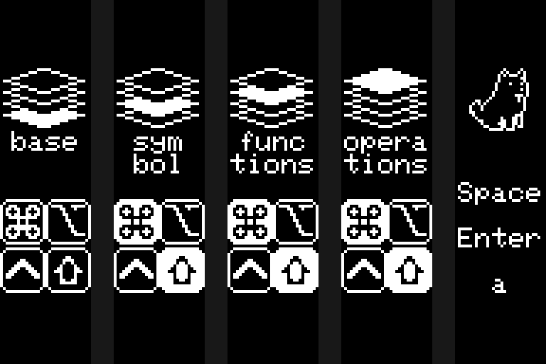

# eva01 — Sofle RGB

The `themakunga_eva01` QMK keymap targets `sofle/v2`. Hardware, key assignments and OLED behavior
are documented below.

## Hardware previsto

- Base: `sofle/rev1`, utilizada por las placas estándar Sofle v1, v2 y RGB.
- Controlador: Pro Micro ATmega32U4, 5 V / 16 MHz, gestor de arranque Caterina.
- USB en la mitad izquierda (`MASTER_LEFT`).
- Matriz estándar: 58 teclas y dos pulsadores de codificador.
- Matriz RGB: 72 LED, 36 por mitad, pin D3.
- OLED: SSD1306, 128 × 32 physical pixels; both halves portrait (32 × 128).

Estos datos proceden de la configuración original. Comprueba las marcas de la placa y el controlador
antes de grabar el firmware. Este destino no describe Sofle Keyhive, Sofle Choc ni un controlador
RP2040. Compara los pines específicos del fabricante con la definición de QMK cuando corresponda.

El flujo de compilación fija QMK 0.34.5 en `b1aea2556040c28d58d611c8aef0082b5780bb6d`. Consulta las
[notas originales del hardware](https://github.com/qmk/qmk_firmware/blob/b1aea2556040c28d58d611c8aef0082b5780bb6d/keyboards/sofle/readme.md).

## Compilación

Desde la raíz de este repositorio, con un entorno QMK existente:

```sh
make setup
make build eva01
make flash eva01
```

Run `make setup QMK_HOME="/path/to/qmk_firmware"` for a custom checkout, or `make update` to refresh
both revision links. See the root README for setup and update behavior.

`themakunga_eva01` is the single target registered in `qmk.json` for QMK userspace builds and
releases. Run `make flash eva01` once per connected half to flash the same image to both. VIA is
disabled; generated firmware is ignored.

## Capas y controles


La imagen sigue las posiciones de `keyboard.json` y las acciones de `keymap.c`. Las teclas atenuadas
heredan la acción base. Cada capa se muestra activada por separado; si mantienes L2 y L3 a la vez,
QMK resuelve primero L3, después L2 y finalmente la base. Los círculos representan los pulsadores de
los codificadores.

Use the **US** keyboard layout in the operating system. The base is QWERTY with Ctrl in the Caps
Lock position. The lower-left corner sends **Ctrl+S**; Ctrl remains available on the A row. The left
thumb order is **Ctrl+S · Alt · Mac · L2 · Space**; Mac sends Command (`KC_LGUI`).

Mantén **L2** (`MO(1)`, capa QMK 1) para símbolos y **L3** (`MO(2)`, capa QMK 2) para funciones,
multimedia y RGB. Al soltar la tecla vuelves a la capa anterior. El pulgar derecho usa una secuencia
de toques: uno envía Espacio, dos envían Enter y Shift más esa tecla envía Enter. Both inner Space
thumb keys send Enter directly on L2 and L3, including when both layers are held.

| Capa                  | Giro izquierdo antihorario / horario | Pulsador izquierdo | Giro derecho antihorario / horario | Pulsador derecho |
| --------------------- | ------------------------------------ | ------------------ | ---------------------------------- | ---------------- |
| Base, QMK 0           | Shift+Arriba / Shift+Abajo           | Botón de ratón 1   | Shift+Izquierda / Shift+Derecha    | Botón de ratón 2 |
| Símbolos, QMK 1       | Alt+Arriba / Alt+Abajo               | Silenciar          | Alt+Izquierda / Alt+Derecha        | Inicio           |
| Multimedia/RGB, QMK 2 | Bajar / subir volumen                | Silenciar          | Bajar / subir brillo de pantalla   | GUI+Ctrl+Q       |

En las capas superiores, la función personalizada convierte `KC_DOWN` en `KC_UP`, incluidas las
teclas heredadas. Por eso la imagen muestra Arriba en esas posiciones, incluso en la zona de
navegación de L3. La base mantiene Abajo. La combinación GUI+Ctrl+Q bloquea la sesión en macOS.

El mapa conserva sus modificadores, teclas de función y controles multimedia y RGB.
`MOUSEKEY_MOVE_DELTA` es 16; el brillo RGB se limita a 100/255, con valor inicial 64/255 y tono
violeta 191/255. La configuración guardada en EEPROM puede reemplazar los valores iniciales.

## OLED and animation

The left display uses 270-degree portrait orientation (32 × 128). A compact stack of four
overlapping 29-pixel-wide planes represents the layers from bottom to top. Only the selected layer
is filled; Base remains outlined while another layer is selected. The name appears below: `base`,
`symbol`, `functions` or `operations`, split over two centered lines when necessary. The 2 × 2
modifier grid shows Command/Option above Control/Shift, with 12 × 12 symbols inside rounded 16 × 16
cells and one blank pixel between rows. A clear inner margin separates each symbol from its border.
Held modifiers invert their icons.

The right display uses 270-degree portrait orientation (32 × 128). It shows Luna using the original
ten 32 × 24 frames by HellSingCoder, followed by the last **three** transmitted keyboard outputs,
oldest above newest. Shortcut flags (`M`, `A`, `C`, `S`) stay attached to their output.

Both compositions are centered horizontally and vertically. With Luna resting and the history
populated, both displays have 24-pixel top and 25-pixel bottom margins. Luna's jump remains relative
to its resting position.

The current keymap still defines only `base`, `symbol` and `functions`; the `operations` display
state is prepared, but its key assignments and activation are pending a decision.



The USB master observes final QMK 6-key reports, including tap dance, Shift overrides and arrow
remaps. Releases and modifier/layer-only actions preserve all three history entries. US Shift and
Caps Lock affect labels; host input methods, dead keys and text transformations remain outside the
keyboard's view. Mouse, RGB and consumer/media reports do not replace the history.

Luna sits at up to 10 WPM, walks at 11–40 and runs above 40. Control makes it sneak, Caps Lock makes
it bark (with priority over Control), and Space makes it jump. Short Space taps survive release;
held Space keeps the dog raised. Luna animates every 200 ms and both displays sleep after 60 seconds
of input/LED inactivity. A 29-byte RPC packet synchronizes active layers, modifiers, three outputs
and Luna state, with attempts limited to once per 50 ms. See
[asset provenance and licenses](../../../../../users/eva/ASSETS.md).

Both halves use the same firmware image. Keep USB on the left for normal use and update both halves
together; previous RPC state formats are incompatible. Verify both display orientations and split
behavior on physical hardware.

## Comprobaciones locales

Ejecuta desde la raíz del repositorio:

```sh
python3 scripts/check_oled.py
```

Python 3 and a C compiler are required. The check verifies key and encoder assignments and compiles
the actual OLED module with local substitutes. It covers final USB-report forwarding, characters and
shortcuts, all modifier combinations, layer changes, RPC retries, both display bounds and all Luna
states. It compiles both master/peripheral render paths and checks sleep and short/held Space jumps.

These checks do not validate physical pins, encoder direction, OLED orientation, actual brightness
or final firmware size. Hardware validation requires building and testing the firmware on the board.
