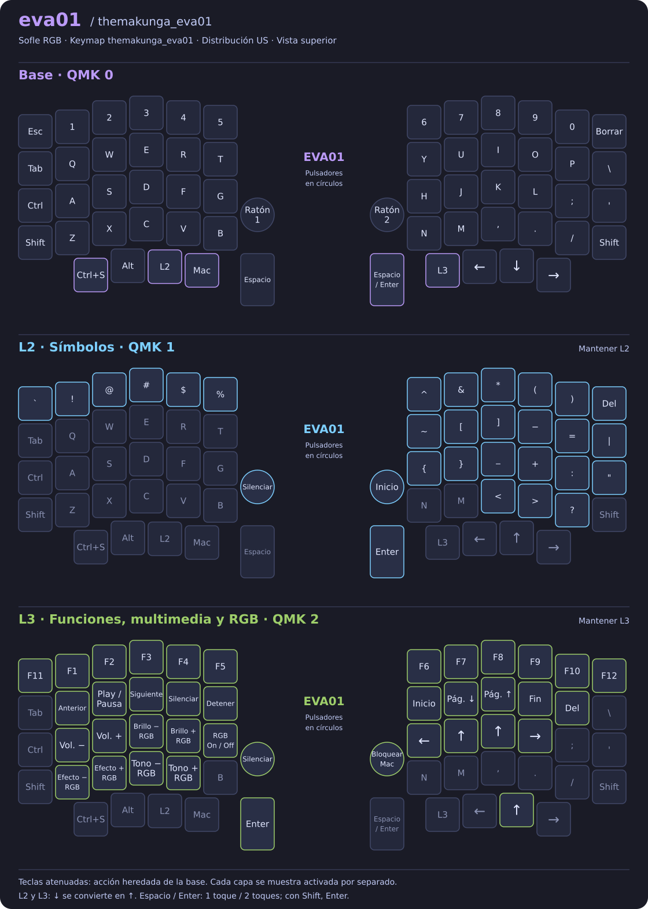

# eva01 — Sofle RGB

Mapa QMK `nicolas`, migrado desde
[`themakunga/public-dotfiles`](https://github.com/themakunga/public-dotfiles/tree/d04247cea7cb029a036994025541a2ba4762d9c0/qmk/sofle/nicolas).
El teclado se llama `eva01`, su destino QMK es `themakunga/eva01` y el mapa conserva el nombre
`nicolas`. Se mantiene la configuración de origen, con los cambios de teclas documentados abajo.

## Hardware previsto

- Base: `sofle/rev1`, utilizada por las placas estándar Sofle v1, v2 y RGB.
- Controlador: Pro Micro ATmega32U4, 5 V / 16 MHz, gestor de arranque Caterina.
- USB en la mitad izquierda (`MASTER_LEFT`).
- Matriz estándar: 58 teclas y dos pulsadores de codificador.
- Matriz RGB: 72 LED, 36 por mitad, pin D3.
- OLED: SSD1306, 128 × 32 píxeles, orientación horizontal.

Estos datos proceden de la configuración original. Comprueba las marcas de la placa y el controlador
antes de grabar el firmware. Este destino no describe Sofle Keyhive, Sofle Choc ni un controlador
RP2040. Compara los pines específicos del fabricante con la definición de QMK cuando corresponda.

El flujo de compilación fija QMK 0.34.5 en `b1aea2556040c28d58d611c8aef0082b5780bb6d`. Consulta las
[notas originales del hardware](https://github.com/qmk/qmk_firmware/blob/b1aea2556040c28d58d611c8aef0082b5780bb6d/keyboards/sofle/readme.md).

## Compilación

Desde la raíz de este repositorio, con un entorno QMK existente:

```sh
export QMK_HOME="$HOME/qmk_firmware"
test ! -e "$QMK_HOME/keyboards/themakunga" &&
  test ! -L "$QMK_HOME/keyboards/themakunga" &&
  ln -s "$(pwd)/keyboards/themakunga" "$QMK_HOME/keyboards/themakunga"
qmk config user.qmk_home="$QMK_HOME"
qmk config user.overlay_dir="$(pwd)"
qmk compile -kb themakunga/eva01 -km nicolas
```

Ajusta `QMK_HOME` a tu copia local de QMK Firmware. El enlace se configura una vez y conserva
cualquier directorio o enlace existente. `keyboard.json` combina los metadatos compartidos de Sofle
y la definición rev1 de la revisión QMK fijada; solo cambia el nombre del teclado y su responsable.
Las funciones de la placa siguen procediendo de `keyboards/sofle/sofle.c` mediante `rules.mk`.

El destino está registrado en `qmk.json`, por lo que también se compila con `qmk userspace-compile`.
Ambas mitades utilizan el mismo firmware. VIA está desactivado y Git ignora los archivos de firmware
generados.

## Capas y controles



La imagen sigue las posiciones de `keyboard.json` y las acciones de `keymap.c`. Las teclas atenuadas
heredan la acción base. Cada capa se muestra activada por separado; si mantienes L2 y L3 a la vez,
QMK resuelve primero L3, después L2 y finalmente la base. Los círculos representan los pulsadores de
los codificadores.

Utiliza la distribución **US** en el sistema operativo. La base es QWERTY con Ctrl en la posición de
bloqueo de mayúsculas. La esquina inferior izquierda envía **Ctrl+S**; Ctrl sigue disponible en la
fila de A. En los pulgares izquierdos, **L2** está entre Alt y **Mac**; Mac envía Command
(`KC_LGUI`).

Mantén **L2** (`MO(1)`, capa QMK 1) para símbolos y **L3** (`MO(2)`, capa QMK 2) para funciones,
multimedia y RGB. Al soltar la tecla vuelves a la capa anterior. El pulgar derecho usa una secuencia
de toques: uno envía Espacio, dos envían Enter y Shift más esa tecla envía Enter. En L2 esa tecla
envía Enter directamente; en L3, la tecla de Espacio del pulgar izquierdo envía Enter.

| Capa                  | Giro izquierdo antihorario / horario | Pulsador izquierdo | Giro derecho antihorario / horario | Pulsador derecho |
| --------------------- | ------------------------------------ | ------------------ | ---------------------------------- | ---------------- |
| Base, QMK 0           | Shift+Arriba / Shift+Abajo           | Botón de ratón 1   | Shift+Izquierda / Shift+Derecha    | Botón de ratón 2 |
| Símbolos, QMK 1       | Alt+Arriba / Alt+Abajo               | Silenciar          | Alt+Izquierda / Alt+Derecha        | Inicio           |
| Multimedia/RGB, QMK 2 | Bajar / subir volumen                | Silenciar          | Bajar / subir brillo de pantalla   | GUI+Ctrl+Q       |

En las capas superiores, la función personalizada convierte `KC_DOWN` en `KC_UP`, incluidas las
teclas heredadas. Por eso la imagen muestra Arriba en esas posiciones, incluso en la zona de
navegación de L3. La base mantiene Abajo. La combinación GUI+Ctrl+Q bloquea la sesión en macOS.

El mapa conserva sus modificadores, teclas de función y controles multimedia y RGB.
`MOUSEKEY_MOVE_DELTA` es 16; el brillo RGB se limita a 100/255, con valor inicial 64/255 y tono
violeta 191/255. La configuración guardada en EEPROM puede reemplazar los valores iniciales.

## OLED y animación

El OLED izquierdo muestra el nombre del teclado y recordatorios de las capas. El derecho muestra la
capa activa, indicadores de modificadores, las últimas tres pulsaciones y Bongo Cat. El estado se
sincroniza mediante RPC de QMK; la animación reacciona a las pulsaciones y vuelve al reposo después
de 220 ms.

El código original de Bongo Cat atribuye la autoría a
[dancarroll/qmk-bongo](https://github.com/dancarroll/qmk-bongo), James Incandenza, pixelbenny y
obosob. Se conservan los avisos de derechos de autor y ambos archivos de licencia originales. El
texto completo de la GPL está en [LICENSE](LICENSE); el archivo heredado `bongo/LICENSE` está vacío.
`rules.mk` compila `bongo/bongo_cat.c`; la copia adicional en la raíz se conserva del repositorio de
origen.

El OLED utiliza la fuente ASCII reducida de QMK incluida, con caracteres visibles del 32 al 126. La
orientación física debe comprobarse en el montaje real.

## Comprobaciones locales

Ejecuta desde la raíz del repositorio:

```sh
python3 keyboards/themakunga/eva01/keymaps/nicolas/check_oled.py
```

Se necesitan Python 3 y un compilador de C. La comprobación verifica las asignaciones de teclas y
codificadores, y compila el módulo OLED real con sustitutos locales. Cubre etiquetas, historial,
modificadores, estado de capas, nuevos intentos RPC, límites de pantalla y conservación de los
píxeles centrales de la animación.

Estas comprobaciones no validan los pines físicos, el sentido real de los codificadores, la
orientación del OLED, el brillo real ni el tamaño final del firmware. No se ha grabado el teclado
como parte de esta migración.
