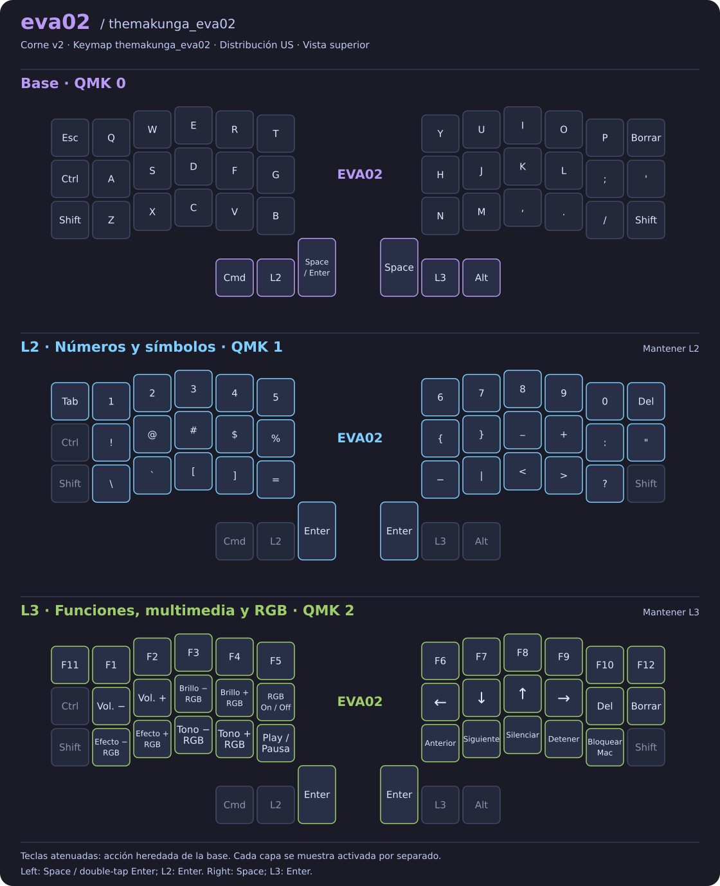

# eva02 — Corne v2

Mapa `nicolas` para `themakunga/eva02`, basado en la distribución de eva01 y adaptado a las 42
teclas del Corne v2. Mantiene QWERTY, Ctrl en la fila de A, Ctrl+S, Mac y tres capas.

## Hardware previsto

- Corne v2 estándar, 42 teclas, distribución `LAYOUT_split_3x6_3`.
- Pro Micro ATmega32U4, 5 V / 16 MHz, gestor de arranque Caterina.
- USB en la mitad izquierda (`MASTER_LEFT`), comunicación serie por D2.
- Matriz: filas D4, C6, D7 y E6; columnas F4, F5, F6, F7, B1 y B3.
- Matriz RGB opcional: 54 LED, 27 por mitad, datos por D3.
- OLED SSD1306 opcional: 128 × 32 píxeles, con nombre y capa activa en ambas mitades.
- Sin codificadores ni pulsadores adicionales.

Este perfil declara el controlador Pro Micro estándar; comprueba el controlador real antes de
grabarlo. Un Corne con RP2040 necesita una conversión de controlador y su firmware correspondiente.
No utilices este archivo `.hex` directamente en un RP2040. Tampoco corresponde a Corne v4 ni a la
variante de 36 teclas.

QMK asigna Corne v1–v3 al destino original `crkbd/rev1`. `keyboard.json` combina sus metadatos
compartidos y la definición rev1 de QMK 0.34.5, revisión `b1aea2556040c28d58d611c8aef0082b5780bb6d`;
solo cambia el nombre del teclado y su responsable. Consulta la
[documentación original de Corne](https://github.com/qmk/qmk_firmware/blob/b1aea2556040c28d58d611c8aef0082b5780bb6d/keyboards/crkbd/readme.md).
Los metadatos conservan la autoría de foostan; la licencia GPL se incluye en
[LICENSE](../../LICENSE).

## Distribución y capas



Configura **US** en el sistema operativo. Las teclas atenuadas heredan la base y cada capa se
muestra activada por separado. Si mantienes L2 y L3 simultáneamente, QMK resuelve L3, luego L2 y
finalmente la base.

- **Base (QMK 0):** letras y puntuación en las mismas columnas que eva01. Esc queda arriba a la
  izquierda; Ctrl, en la fila de A; Shift, en ambos extremos inferiores.
- **Pulgares izquierdos:** Ctrl+S, L2 (`MO(1)`) y Mac/Command, en ese orden.
- **Pulgares derechos:** Espacio / Enter, L3 (`MO(2)`) y Alt. Un toque envía Espacio, dos envían
  Enter y Shift más esa tecla envía Enter. Esta acción se conserva en las tres capas.
- **L2 · Números y símbolos (QMK 1):** mantener L2 coloca 1–0 sobre las letras superiores; con Shift
  produce sus símbolos US. Tab queda en la esquina superior izquierda y Suprimir a la derecha. Las
  filas restantes incluyen barras, comillas, llaves, corchetes y operadores.
- **L3 · Funciones y multimedia (QMK 2):** mantener L3 activa F1–F12, las cuatro flechas en H/J/K/L,
  volumen, reproducción, brillo, efectos y tono RGB. La combinación Mac+Ctrl+Q bloquea la sesión en
  macOS.

eva02 conserva **Abajo** en L3: las cuatro direcciones siguen disponibles aunque no haya flechas
dedicadas en la base. Los números y las funciones pasan a capas porque el Corne no tiene la fila
numérica del Sofle. No se utilizan modificadores al mantener teclas de letras ni retardos de
pulsación para acceder a las capas.

El brillo RGB máximo es 100/255, con valor inicial 64/255 y tono violeta 191/255. Los valores
guardados en EEPROM pueden reemplazar estos ajustes. Este mapa incluye un indicador OLED sencillo;
la animación Bongo Cat y los controles de codificador pertenecen a eva01.

## Compilación

Desde la raíz del repositorio, con un entorno QMK existente:

```sh
export QMK_HOME="$HOME/qmk_firmware"
test ! -e "$QMK_HOME/keyboards/themakunga" &&
  test ! -L "$QMK_HOME/keyboards/themakunga" &&
  ln -s "$(pwd)/keyboards/themakunga" "$QMK_HOME/keyboards/themakunga"
qmk config user.qmk_home="$QMK_HOME"
qmk config user.overlay_dir="$(pwd)"
qmk compile -kb themakunga/eva02 -km nicolas
```

Ajusta `QMK_HOME` a tu copia local de QMK Firmware. Si ya creaste el enlace para eva01, sirve
también para eva02. El enlace conserva cualquier directorio o enlace existente.

`qmk userspace-compile` compila ambos teclados registrados. **Build QMK firmware** y **Promote
release** incluyen automáticamente eva02 mediante `qmk.json`. Ambas mitades utilizan el mismo
firmware. VIA está desactivado.

## Comprobaciones

```sh
python3 scripts/check_eva02.py
pre-commit run --all-files
```

Ejecuta desde la raíz. La comprobación local valida los pines declarados, las 42 posiciones por
capa, el acceso a las capas, las teclas principales y la correspondencia de la imagen con el mapa.
La compilación QMK comprueba el firmware completo. Ninguna de estas comprobaciones verifica el
controlador instalado, el cableado, la orientación física del OLED ni el brillo real de los LED.
